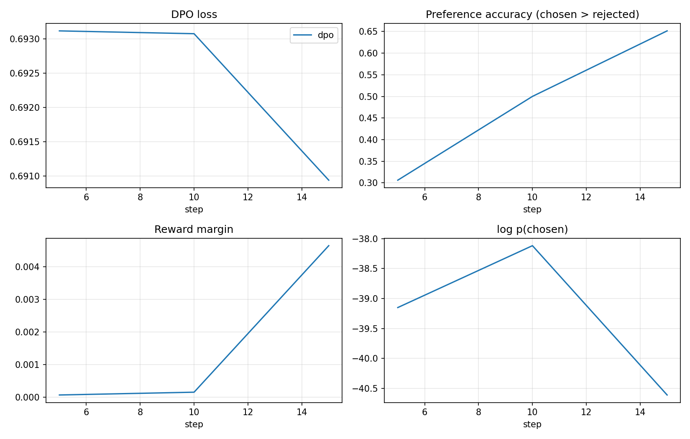

# SFT → DPO with verifiable preference pairs


A small post-training pipeline for math reasoning on GSM8K:

1. **SFT**: supervised fine-tuning of Qwen2.5-0.5B-Instruct on GSM8K reference
   solutions rewritten into a `<think>…</think><answer>…</answer>` format.
2. **Synthetic preference data**: the SFT model samples K answers per training
   question. Each answer is checked against the gold number, so pairs are
   labelled **without a reward model or human annotators**.
3. **DPO** on these (correct, incorrect) pairs, with ablations on β, the loss
   (DPO vs. IPO) and how the rejected answers are chosen.

The question studied: *how much can preference optimisation on the model's own
verified samples improve over SFT, and which choices matter?*

## Pipeline

```
GSM8K train ──► SFT (LoRA, merged) ──► sample K=8 answers / question
                                              │
                                   verify final number
                                              │
            ┌─────────────────────────────────┼──────────────────────────┐
     all correct (dropped)        mixed → (chosen, rejected)      all wrong (dropped)
                                              │
                                     DPO (LoRA on SFT model)
                                              │
                                   greedy eval on GSM8K test
```

### Building the pairs (`src/sftdpo/pairs.py`)

- A sample is **chosen** only if its answer is correct *and* it follows the
  format.
- Questions where all K samples are correct, or none is, give no preference
  signal and are dropped. The share of each case is saved in
  `pairs.stats.json`, together with pass@K.
- `strategy: hard` (default) picks rejected answers that are **well formatted
  but wrong**, so chosen and rejected differ in reasoning rather than format.
  `strategy: random` is the control.
- Only the train split is sampled, so the test set is never seen.

### DPO

DPO optimises the policy directly from pairs (y_w ≻ y_l):

$$\mathcal L = -\log\sigma\Big(\beta\log\frac{\pi_\theta(y_w|x)}{\pi_{\text{ref}}(y_w|x)} - \beta\log\frac{\pi_\theta(y_l|x)}{\pi_{\text{ref}}(y_l|x)}\Big)$$

The reference model is the SFT model. Since the SFT adapter is merged before
DPO and DPO trains a new LoRA adapter, TRL gets the reference by disabling the
adapter, so only one copy of the weights stays in memory.

## Ablations

| run | what changes |
|---|---|
| `dpo` | β = 0.1, sigmoid loss, hard negatives |
| `dpo_beta0.05` / `dpo_beta0.5` | strength of the KL constraint |
| `dpo_ipo` | IPO loss (squared loss, less prone to over-fitting the margin) |
| `dpo_random_neg` | random instead of hard negatives |

## Usage

```bash
pip install -r requirements.txt && pip install -e .

python scripts/train_sft.py   --config configs/sft.yaml
python scripts/build_pairs.py --config configs/sampling.yaml
python scripts/train_dpo.py   --config configs/dpo.yaml
python scripts/evaluate.py    --model outputs/dpo/merged --out results/dpo

# everything, including ablations and baselines
bash scripts/run_all.sh
python scripts/plot.py --runs dpo dpo_beta0.05 dpo_beta0.5 dpo_ipo dpo_random_neg
```

Any config value can be overridden from the command line, e.g.
`train.beta=0.5` or `"train.loss_type=[ipo]"`.

No GPU? `notebooks/colab_quickrun.ipynb` runs a shortened pipeline on a free T4.

### Tests

```bash
pytest -q
```

Runs offline on CPU. The smoke test trains a tiny random Llama with SFT, merges
it and runs DPO on top (with and without LoRA), so the whole training path is
checked in CI.

## Results

### First Colab run (T4)

Shortened pipeline from `notebooks/colab_quickrun.ipynb`:
- SFT on 2,000 GSM8K questions for 1 epoch (LoRA);
- pairs from 500 training questions × 4 samples;
- DPO for 1 epoch on the resulting pairs (β = 0.1, sigmoid loss, LoRA,
  lr 5e-6);
- greedy evaluation on the same 300 test questions for every model.

Raw outputs, logs and figures are in
[`docs/results/colab_v1`](docs/results/colab_v1). Lenient accuracy was
recomputed afterwards from the saved outputs.

| model | accuracy (tagged) | accuracy (lenient) | format rate | mean length (chars) |
|---|---|---|---|---|
| Qwen2.5-0.5B-Instruct (zero-shot) | 0.0% | **37.3%** | 0.0% | 875 |
| + SFT | 28.3% | **28.3%** | 99.7% | 231 |
| + SFT + DPO | 29.3% | **29.3%** | 99.3% | 233 |

*Tagged* counts only the number inside `<answer>`; *lenient* takes the last
number of the output, which is fairer to the base model since it never uses
the tags.

**Statistics of the generated pairs** (`pairs.stats.json`):

| questions | all 4 samples right | all 4 wrong | mixed → pairs | pairs | pass@4 |
|---|---|---|---|---|---|
| 500 | 33 | 212 | 255 | 449 | 57.6% |



### What the numbers say

**1. SFT taught the format but cost accuracy.** After SFT almost every answer
follows the template (99.7%), and answers are 4× shorter. But lenient
accuracy drops from 37.3% to 28.3%. On the same questions, 58 go from right to
wrong and 31 from wrong to right (exact McNemar test p ≈ 0.006). A likely
cause is the training data: GSM8K reference solutions are terse, while the
instruct model reasons at length, so imitating them shortens its reasoning.
This is a known risk of SFT on short targets. Better options would be SFT on
the model's own verified solutions (rejection-sampling fine-tuning) or a
lower learning rate.

**2. There is room for preference learning.** The SFT model gets 28% with
greedy decoding, but at least one of 4 samples is correct on 57.6% of the
training questions (pass@4). Half of the questions (255/500) give pairs, so
the verified-pairs pipeline does produce signal.

**3. DPO barely trained.** 449 pairs with an effective batch of 32 is only 15
optimisation steps. The DPO loss moves from 0.693 (= log 2, the value at
initialisation) to 0.691, and the reward margin reaches only 0.005. Preference
accuracy on the training batches rises from 0.31 to 0.65, so the direction is
right, but the update is tiny: 241 of the 300 evaluation outputs are identical
to the SFT ones. The +1 point is not significant (7 vs 4 flips, p ≈ 0.55).

### Next steps
- **Give DPO enough steps.** Use more pairs (the full config samples 3,000
  questions × 8), several epochs, and a LoRA learning rate around 5e-5;
  5e-6 is a full fine-tuning value.
- **Replace SFT on references by SFT on self-generated verified solutions**,
  so the model keeps its own reasoning style while learning the format.
- Then run the planned ablations (β, IPO, hard vs. random negatives).

## Project layout

```
configs/            sft.yaml, sampling.yaml, dpo.yaml
src/sftdpo/
  data.py           GSM8K → SFT / eval formats
  verify.py         answer extraction and checking
  generation.py     batched sampling with transformers
  pairs.py          verified preference pairs + statistics
  train.py          SFT / DPO trainers, LoRA merge
  evaluate.py       accuracy, format rate
scripts/            train_sft, build_pairs, train_dpo, evaluate, run_all.sh, plot
tests/              unit tests + CPU smoke test
```

## Notes

- With a small tokenizer, a short `max_length` can truncate away the whole
  completion, and TRL then drops the example as "fully masked". This is the
  reason the smoke test uses `max_length=512`.
- The pass@K reported in the stats is an upper bound on what DPO can teach
  from these pairs: questions the SFT model never solves produce no pairs.

## References

- Rafailov et al., 2023. *Direct Preference Optimization: Your Language Model is Secretly a Reward Model.*
- Azar et al., 2023. *A General Theoretical Paradigm to Understand Learning from Human Preferences* (IPO).
- Pang et al., 2024. *Iterative Reasoning Preference Optimization.*
- Cobbe et al., 2021. *Training Verifiers to Solve Math Word Problems* (GSM8K).
